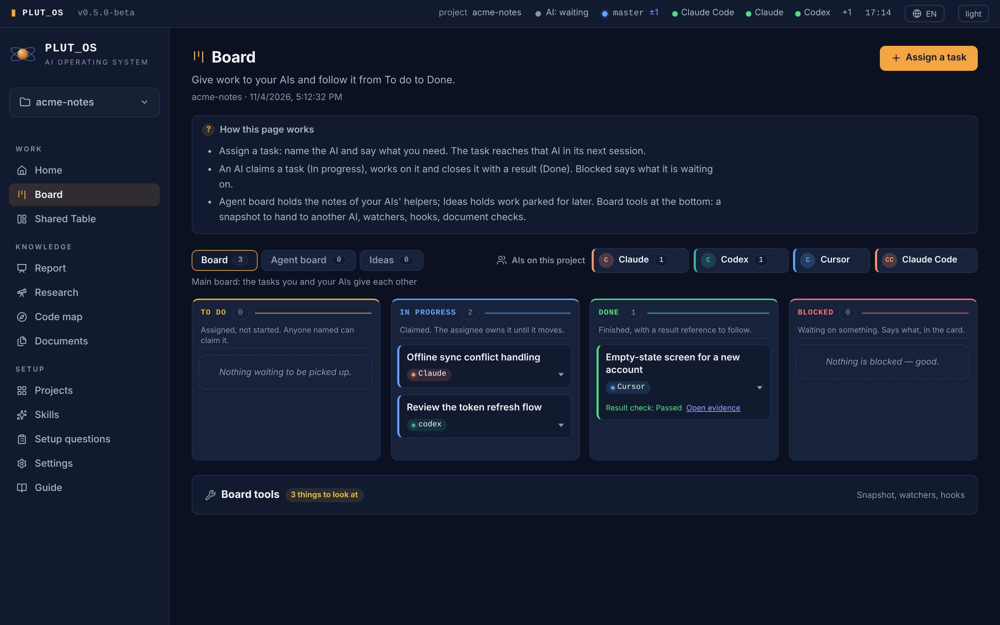
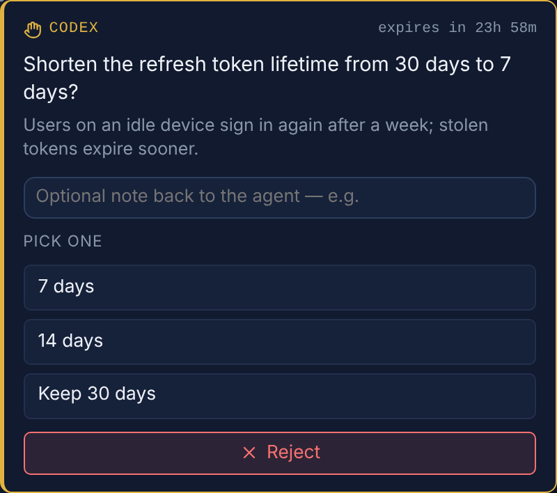
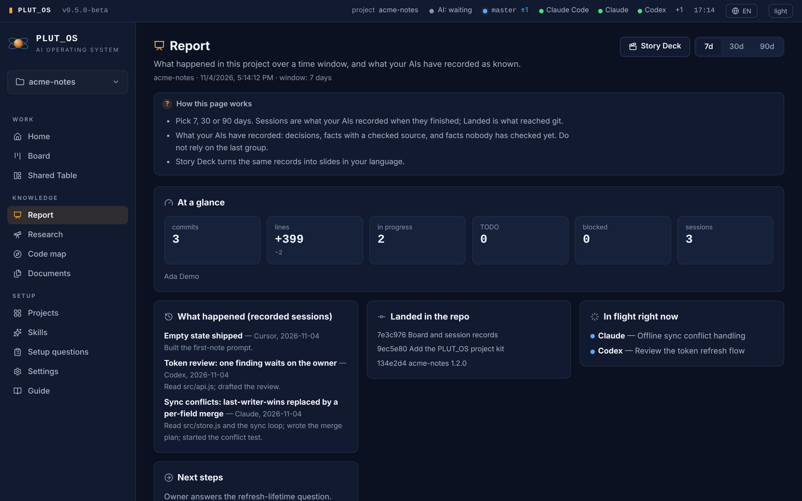

# PLUT_OS — one shared memory and board for all your AI coding tools

  

**Website and downloads: [plut-os.malik3d.page](https://plut-os.malik3d.page)**

PLUT_OS is the memory and hand-off layer between one owner and several AIs: a board, a session record, checks against a false "done", a working agreement in every brief, and a dashboard over the same files.
It is a small local app for people who use more than one AI tool on the same project (Claude Code,
Codex, Cursor, Gemini CLI, Antigravity, Windsurf, Zed, VS Code Copilot…): the AIs coordinate
through plain files in your repo and a local MCP server, and ask you before doing anything that
matters.

> Version `0.5.1`. A **local PC app**, not a website: it runs on `127.0.0.1` / `localhost`
> and nothing is sent to a cloud service. Open source under the Apache License 2.0; Node.js 22+, one runtime dependency.



One page that says what PLUT_OS is, what it is not, what is inside and how to start, in English and
Turkish: open `docs/intro-card.html` in a browser.

## See it on one project

The screenshots come from a small demo project, `acme-notes`. A script played three AIs one after
another (Claude, Codex, Cursor), each through the same MCP calls a real AI tool makes, so the board,
the records and the question below are what PLUT_OS itself wrote and shows.

**Claude** opened the session, took the sync-conflict task, assigned a review to Codex, and closed with
two facts and one decision. Each fact carries the line it was read from:

```text
$ plutos memory list
d-4805d452c9fa            decision  valid     Merge concurrent edits per field instead of last-writer-wins
e9082043308751982b98e056  claim     verified  Sync runs every 30 seconds
b37cf4631f110395142ea93d  claim     verified  Auth tokens live 15 minutes
```

**Codex** took the review Claude assigned to it and reached a decision it should not make alone. It asked; the question waits in the dashboard with the options it offered:



**Cursor** finished its own task with a passed check and the file that shows it. The Report page
puts the three sessions, what reached git and what is still in flight on one screen:



**Then the code changed.** Someone set the sync interval to 60 seconds. The next session's brief
no longer hands the old fact over as true:

```text
$ plutos memory list
e9082043308751982b98e056  claim     stale     Sync runs every 30 seconds

Shared context: 1 source-backed · 1 quarantined (evidence lost) claim(s) …
```

The fact was not deleted and nobody had to remember it was there. Its source line stopped
matching, so it stopped being served as true.

## The problem it solves

When several AIs work on one codebase, the same things go wrong every day:

- **Every new session starts blind.** The next AI does not know what the last one did, decided or
  learned, so you explain the project again, or it guesses.
- **Tools overwrite each other.** Two agents pick up the same task, or one undoes the other,
  because neither can see the other's work.
- **"Memory" goes stale silently.** A note that was true last week is handed to the next AI as a
  fact after the code it describes has changed.
- **You are asked in five different windows.** Each tool has its own "may I?" prompt; the one you
  are not looking at is the one that is stuck.
- **Each project starts with different rules.** One AI writes tests, the other does not; one
  leaves debt, the other cleans up.

## What it makes easier

| Instead of… | PLUT_OS gives you |
|---|---|
| Re-explaining the project every session | `session_start`: one bounded briefing with the board, decisions and checked facts |
| Notes nobody can trust | Claims recorded **with the exact source excerpt and a hash**. If the source changes, the claim is quarantined; if only the rest of the file changed and the excerpt is still there, it is marked *re-check* |
| AIs clashing on the same work | A shared `BOARD.md` with atomic, race-tested writes (two MCP servers writing at once, zero lost updates; the roster's lock holds 16 concurrent writers × 25 entries) and per-entry revision checks |
| Decisions that get lost or quietly reversed | Every decision is a record with its own id; reversing one names the one it replaces, so the chain stays visible (`plutos memory list`, `open`, `supersede`). `plutos memory find` searches decisions, checked facts and past sessions in English and Turkish, and refuses a question nothing in the record answers |
| An AI saying "done" with no test run | The claim check sends a "done" back when the tests did not run or a test was edited in the same fix; `plutos check` fails on records that cite missing files and on a tool, route or approval-rule change that no reviewer looked at |
| Approval prompts scattered across tools | `plutos_ask`: one approval queue in the dashboard. Tickets are sealed so an agent cannot approve itself by editing a file, and `plutos approve` needs an interactive terminal, so an agent with a shell cannot run it either |
| Each agent grepping its way into a task | `plutos_context_for_task`: give it the task in a sentence and get the files to open first, ranked from the code graph, each with the reason it is listed and a confidence |
| Skills scattered per AI tool | A Skills page: the skill folders every connected tool reads, and packs switched on per project into `.claude/skills` and `.agents/skills` at once |
| Every project with different habits | The working agreement in every session brief carries the discipline (reuse before writing, surgical changes, evidence before claims) |

## Who it is for

- A solo developer or a small team using two or more AI coding tools on the same repositories.
- Anyone who wants the AIs to keep a shared, checkable record **inside the repo**, not in a
  vendor's cloud.
- People who want to approve important actions themselves instead of running agents in
  "skip all permissions" mode.

It is **not** an agent runner or a replacement for your AI tools. PLUT_OS does not drive the AIs;
they talk to it through MCP and files ("communication, not control").

## Quick start

**Download and run (nothing to install):**

| Download | For | Then |
|---|---|---|
| [**PLUT_OS for Windows**](https://github.com/Zeatrex01/plutos-multi-agent-memory/releases/latest/download/PLUT_OS-windows-x64.zip) | Windows 10/11 | unzip anywhere, double-click `PLUT_OS.exe` |
| [**PLUT_OS for Linux**](https://github.com/Zeatrex01/plutos-multi-agent-memory/releases/latest/download/PLUT_OS-linux-x64.zip) | Linux x64 | unzip, run `./PLUT_OS` |
| [**PLUT_OS lite**](https://github.com/Zeatrex01/plutos-multi-agent-memory/releases/latest/download/PLUT_OS-lite.zip) | macOS, or any system with Node.js 22+ | unzip, run `./start-plutos.sh` (or `START_PLUT_OS.bat`) |

The dashboard opens in your browser at `http://localhost:3040`. Every release is on the
[releases page](https://github.com/Zeatrex01/plutos-multi-agent-memory/releases); Settings → Updates
says when a newer one is out.

### First run, step by step

1. **Open your project.** In the dashboard, **Projects → Add project** and pick the folder of a
   project you already work on. Nothing is written into it yet.
2. **Install the project kit.** On the project's card, press **Install the project kit**. It adds
   the shared board, the rules file (`AGENTS.md`) and a pointer for each AI tool, and never
   overwrites a file the project already has.
3. **Connect your AI tools.** Still on the card, press **Set up** next to Claude Code, Codex,
   Cursor or Gemini CLI. It writes the small config file that tool reads, and shows you which file
   first. Restart the tool afterwards. (The AI tools start PLUT_OS with Node.js, so they need
   Node.js 22+ installed; most of them do already.)
4. **Work as usual.** Open the AI tool in the project folder and give it a task. It reads the
   brief by itself at the start, claims the task on the board and leaves a record at the end.
5. **Watch and answer.** **Home** shows what needs you; **Board** shows who works on what; a
   question an AI asks you pops up in the dashboard with its options. The next AI you open,
   whichever tool it is, starts from the record the last one left.

**Windows, from source** (Node.js 22+ installed):

1. Clone or download this repository.
2. Double-click `START_PLUT_OS.bat`. On the first run it installs its one dependency with
   `npm ci --omit=dev`, then opens the dashboard at `http://localhost:3040`.
3. In the dashboard: **Projects → Add Project** and pick a folder. Nothing is written into the
   project yet; PLUT_OS only observes it.
4. When you want the project to carry shared coordination: on the open project's card, step 1
   **Install the project kit**; step 2 connects each AI tool (Claude Code, Codex, Gemini CLI and
   Cursor in view, more under **More tools**), showing the exact file it will write.

**Any OS, terminal:**

```bash
git clone https://github.com/Zeatrex01/plutos-multi-agent-memory.git
cd plutos-multi-agent-memory
npm ci --omit=dev
node dashboard.mjs --open
```

**Portable app (no Node on the target machine):** build once with `npm install` and
`npm run build:app` (windowed) or `npm run build` (console), or double-click `BUILD_PLUT_OS.bat`.
The result is `dist/PLUT_OS.exe` (Windows) or `dist/PLUT_OS` (Linux/macOS), a folder you can copy
anywhere.

**Install as an app:** with PLUT_OS running, open it in Chrome or Edge and use **Settings → Install
as an app** (or the install icon in the address bar) for its own window and icon.

**Updating a checkout:** double-click `UPDATE_PLUT_OS.bat`, or run `node cli.mjs update`. It
fast-forwards to the upstream branch, runs `npm install` when the dependencies changed, and lists the
files git neither tracks nor ignores; `--clean` moves them into the Hub instead of deleting them. It
never moves a local commit or overwrites a changed file. Projects need nothing: their launcher uses
this install, and an older launcher is replaced when you open the project. A project set up with an
older version may keep files that version wrote and nothing reads now: `node cli.mjs audit <project>`
lists them and what fixes each (Repair, `--clean` into the Hub, or you). The dashboard's
**Settings → Updates** checks on request and updates a checkout the same way; the portable app shows
whether a newer release exists, with a Download link.

## How it works

```
 Claude Code   Codex   Cursor   Gemini ...        you (dashboard on localhost:3040)
      │          │        │        │                         │
      └──── MCP (stdio) ──┴────────┘                         │
                  │                                          │
          PLUT_OS coordinator  ── reads/writes ──  your repo: AGENTS.md, docs/handoff/BOARD.md,
                                                   CONTEXT.json (checked facts)
```

1. **Prepare.** Add a folder and PLUT_OS maps it without touching it. The Project Kit, installed
   only when you choose, writes `AGENTS.md`, the boards, pointer files for each AI
   (`CLAUDE.md`, `GEMINI.md`, `.cursor/rules/plutos.mdc`), launchers. It never
   overwrites a file the project already has.
2. **Remember.** Each AI opens with `session_start` and closes with `session_end`. Decisions,
   learned claims with evidence, and where work stopped are carried to the next session, whichever
   AI it is.
3. **Coordinate.** Tasks are claimed, updated and finished on the shared board. Questions that
   need you go to the approval queue. The Board and Home pages show who works on what.

Also there: a blind **Shared Table** council (several AIs answer independently, then you decide),
a source-backed research studio, and the Skills page, where a pack of Agent Skills is switched on per
project. PLUT_OS ships no field's skills of its own: a domain lives in its own pack. Off until you
turn it on: a code graph (`graphify`).

## Evidence

What has been measured, how, and what has not.

| Claim | How it was measured | Result |
|---|---|---|
| `memory find` answers from the record better than reading the brief and grepping | Three probe sets written blind of each other (86, 60 and 60 questions, half English, half Turkish, some about things never recorded) over the 229 records of PLUT_OS's own development; `tools/memory-probe-eval.mjs` | The right record in the top 5: **78.9% vs 61.3%**, **72.9% vs 62.5%**, **68.8% vs 54.2%** |
| It refuses a question nothing in the record answers | The same sets' false-premise questions | 61%, 17% and 33% refused, against 6%, 0% and 0% for brief plus grep. Better, and still uneven |
| A session's opening brief stays small | `tools/token-budget-test.mjs` on a fresh project | **728 tokens** |
| The rules cost less without doing worse | The same 6 tasks, 3 trials each, on fresh clones before and after the brief was cut (`tools/harness-bench.mjs`) | 18/18 passed both times; tokens per task **−5.6%**, time **−14%** (medians) |
| Two AIs writing at once lose nothing | Race tests in `tools/smoke-test.mjs`: two MCP servers on one board; 16 processes × 25 roster entries | Zero lost updates |
| It works on a clean machine | `npm test`, every suite, run by CI on every push | All pass |

**Not shown yet:** a comparison of the same multi-AI project run with and without PLUT_OS, and use
by people other than its author. The probe sets are keyed to PLUT_OS's private working records,
so they are not shipped; the evaluator is. On a project with only a handful of records,
`memory find` answers fewer questions than the numbers above, because a word shared by two of six
records already counts as common.

## Safety model

- The dashboard binds to `127.0.0.1` only and checks `Host` and `Origin` on every request; there
  is no password, session or device list, and nothing to turn the LAN on.
- A request that arrives through a proxy or tunnel is refused even on loopback: a forwarding
  header makes it remote.
- PLUT_OS starts AI turns in two places, and neither asks for a ticket: the Shared Table council,
  whose moderator starts a Codex or Antigravity turn each time it asks a department through
  `tools/council.mjs`, and automatic shared-context capture, which runs `claude -p` with Haiku
  after a compaction or session end once you switch it on for a project.
- Approvals are tied to the exact content hash they were given for, expire, and run once;
  `plutos approve` and `plutos reject` need an interactive terminal, so an AI with a shell on the
  computer PLUT_OS runs on cannot answer its own ticket from a script. The dashboard's question card
  is your browser action. What is not checked: a terminal an AI drives through a pseudo-terminal.
- Checks, and the clients they work in today: the claim check sends a false "done" back once
  (Claude Code and Codex); the push gate stops a push of untested work (Claude Code, and every
  other client and the terminal through a git pre-push hook, which `git push --no-verify` skips); the
  guard stops destructive git and delete commands (Claude Code only); all three are off until you
  switch them on for a project; `plutos check` lists what the records name that the repository does not show
  (a terminal command, so any client).
- No telemetry, no account, no API keys: PLUT_OS uses the AI tools you already have installed.

## Where data lives

| Data | Location |
|---|---|
| Project list, logs, the approval seal key | Windows `%LOCALAPPDATA%\PLUT_OS`; macOS `~/Library/Application Support/PLUT_OS`; Linux `~/.local/share/plut-os` (override with `PLUTOS_HOME`) |
| Boards, decisions, session history, checked facts | The project's `docs/handoff/` |
| Code index | The project's `docs/ai/` |
| Per-machine binding | The project's gitignored `.plutos/` |

## Development

```bash
npm install
npm test          # every suite: smoke, MCP protocol, build tool, approvals, council…
npm run dev       # development mode (Windows: DEV_PLUT_OS.bat)
```

**Development mode** is PLUT_OS working on itself, kept apart from the PLUT_OS you use. It has
its own data folder (`PLUT_OS-dev` beside the normal one) and port 3041, so both run side by
side; it opens on PLUT_OS's own checkout and can add projects only from its `sandbox` folder,
never your real ones. A panel banner and the `[DEV]` tab title make it impossible to mistake.
Coordinate the AIs that work on PLUT_OS from your normal, stable PLUT_OS; when an AI's project is
PLUT_OS itself, `session_start` tells it so.

More: [docs/GUIDE.md](docs/GUIDE.md), the full guide and the MCP tool list.

## License

Apache License 2.0 ([LICENSE](LICENSE)); third-party notices in [NOTICE](NOTICE). Contributions are
welcome under the same licence ([CONTRIBUTING.md](CONTRIBUTING.md)); report a security problem
privately ([SECURITY.md](SECURITY.md)).
